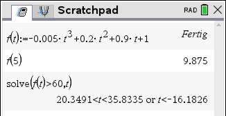

# CAS Cheat Sheet

Schritt-für-Schritt-Anleitungen für den TI-Nspire CX CAS, gebaut fürs Smartphone.

## Ordner

```
index.html        ← alle Inhalte (Themen, Aufgaben, Schritte)
css/style.css     ← Aussehen (Farben, Größen)
js/app.js         ← Steuerung (muss man normalerweise nicht anfassen)
bilder/           ← Rechnerbilder
fonts/            ← TI-Tastenschrift
```

## Ansehen

`index.html` per Doppelklick im Browser öffnen.
In VS Code mit der Erweiterung **Live Server**: Rechtsklick auf `index.html` → „Open with Live Server“. Dann lädt die Seite bei jedem Speichern neu.

## Inhalte ändern (alles in `index.html`)

Jedes Thema ist ein Block `<section class="thema" id="t1"> … </section>`.
Die Nummern und die Themenliste auf der Startseite entstehen automatisch.
Ein neues Thema: einen Block kopieren, `id` ändern (z. B. `t7`), Inhalt anpassen.

| Was | So schreibt man es |
|---|---|
| Neuer Schritt | `<div class="schritt"> <h2>Titel</h2> … </div>` |
| Teil a/b über dem Schritt | `<div class="schritt" data-teil="Teil a">` |
| Befehl | `<code>solve(f(x)=0,x)</code>` |
| TI-Taste | `<kbd>b</kbd>` (Tabelle unten) |
| Tastenfolge groß | `<p class="tasten"><kbd>b</kbd> + <kbd>3</kbd> + <kbd>1</kbd></p>` |
| Formel | `<span class="m"><i>f</i>(<i>x</i>) = <i>x</i>²</span>` |
| Bruch | `<span class="fr">1/2</span>` |
| Ergebnis-Kasten | `<div class="ergebnis"><span>N₁(2 \| 0)</span></div>` |
| Grauer Hinweis | `<p class="hinweis">…</p>` |
| Hinweis-Kasten | `<p class="notiz">…</p>` |
| Teilaufgaben in der Aufgabe | `<ol><li data-nr="a)">…</li></ol>` |

### Rechnerbilder

```html

```

Zeilen im Bild rot markieren:

```html

```

- `data-zeilen`: Pixelbereiche der Zeilen im Bild (von oben gemessen, z. B. in einem Bildprogramm)
- `data-markiert`: welche Zeile in diesem Schritt rot umrandet wird
- `data-nummern="a, b"`: statt 1, 2, 3 andere Beschriftungen

Steht dasselbe Bild in mehreren Schritten hintereinander, zeigt „Alle Schritte“ es nur einmal.

## TI-Tasten (Schrift TINspireKeysCX)

| Taste | Zeichen | | Taste | Zeichen |
|---|---|---|---|---|
| menu | `b` | | enter | `·` |
| ⌂ on | `c` | | ctrl | `/` |
| esc | `d` | | del | `.` |
| tab | `e` | | doc | `~` |
| shift | `g` | | Vorlagen ⊞ | `t` |
| var | `h` | | (−) | `v` |
| EE | `i` | | x² | `q` |
| ^ | `l` | | eˣ | `u` |
| ÷ | `p` | | 10ˣ | `s` |
| × | `r` | | = | `=` |
| + | `+` | | − | `-` |
| ( ) | `(` `)` | | , | `,` |
| Ziffern | `0`–`9` | | Buchstaben | `A`–`Z` |
| Leertaste | `_` | | Punkt | `^` |

## Farben ändern

In `css/style.css` ganz oben unter `:root`. Darunter stehen die Farben für den Dunkelmodus.

## Online stellen mit GitHub Pages

1. Ordner als Repository auf GitHub hochladen.
2. Im Repository: **Settings → Pages → Branch: main, Ordner: / (root) → Save**.
3. Nach etwa einer Minute ist die Seite unter `https://DEIN-NAME.github.io/REPO-NAME/` erreichbar.

Direktlinks zu einem Thema: Adresse plus `#t1` … `#t6`, z. B. für QR-Codes.
